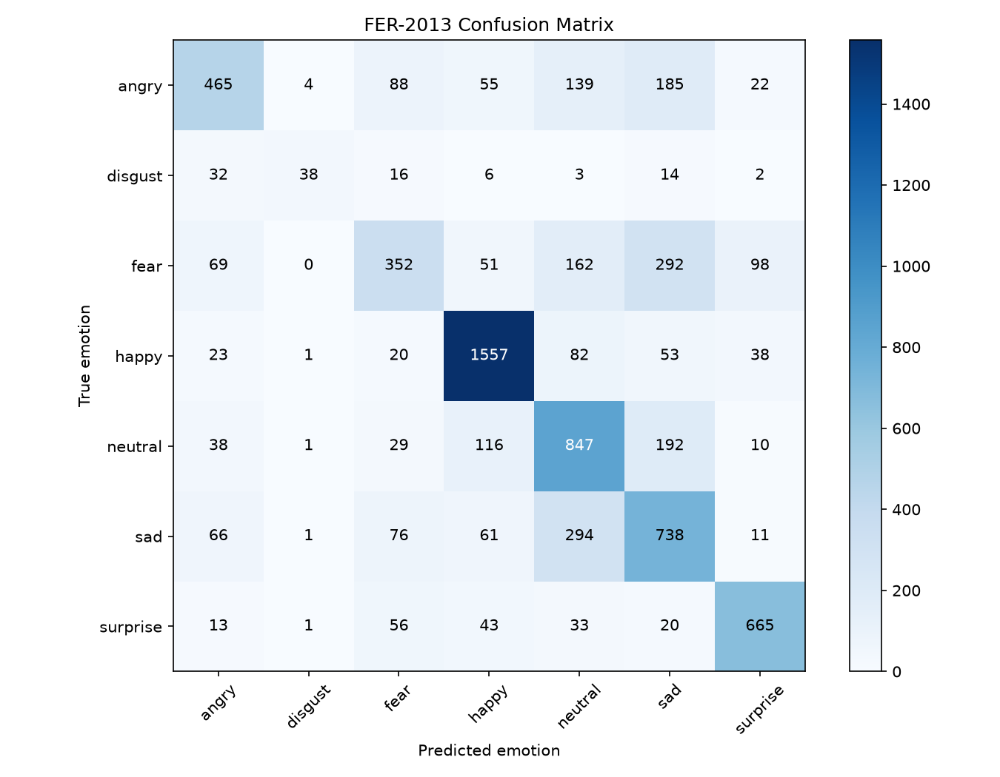

# Real-Time Facial Expression Recognition

A real-time facial expression recognition system built with PyTorch and a custom Convolutional Neural Network (CNN), trained from scratch on the FER-2013 dataset.

The system classifies facial expressions into seven categories and supports webcam-based real-time inference.

## Features

- Custom CNN architecture implemented with PyTorch
- Trained from scratch without pretrained model weights
- Seven-class facial expression classification
- Real-time webcam inference using OpenCV
- Model evaluation with per-class accuracy and a confusion matrix
- GPU acceleration with CUDA when available

## Supported Emotions

- Angry
- Disgust
- Fear
- Happy
- Neutral
- Sad
- Surprise

## Model Architecture

The model consists of four convolutional blocks with 32, 64, 128, and 256 channels.

Each block uses convolution, batch normalization, ReLU activation, and max pooling. Adaptive average pooling and fully connected layers produce the final seven-class prediction.

Input image size: 48 × 48 pixels, grayscale.

## Dataset

This project uses the FER-2013 facial expression dataset.

The dataset contains seven emotion categories. Images are converted to grayscale and normalized before being passed to the model.

During training, random horizontal flipping and small random rotations are used for data augmentation.

Please obtain the dataset from an authorized source and arrange it as follows:

    data/
    ├── train/
    │   ├── angry/
    │   ├── disgust/
    │   ├── fear/
    │   ├── happy/
    │   ├── neutral/
    │   ├── sad/
    │   └── surprise/
    └── test/
        ├── angry/
        ├── disgust/
        ├── fear/
        ├── happy/
        ├── neutral/
        ├── sad/
        └── surprise/

## Results

The best validation accuracy reached 65.38%, and the final test accuracy was 64.95%.

Evaluation results by class:

| Emotion | Accuracy |
|---|---:|
| Angry | 48.54% |
| Disgust | 34.23% |
| Fear | 34.38% |
| Happy | 87.77% |
| Neutral | 68.69% |
| Sad | 59.18% |
| Surprise | 80.02% |

### Confusion Matrix

The confusion matrix below shows the model's predictions on the test set.

## Installation

Python 3.11 is recommended.

Create and activate a virtual environment:

    python -m venv .venv

On Windows PowerShell:

    .venv\Scripts\Activate.ps1

Install dependencies:

    python -m pip install -r requirements.txt

Install a PyTorch build compatible with your hardware if the default installation does not support your GPU. See the official PyTorch installation guide:
https://pytorch.org/get-started/locally/

## Dataset Preparation

Place the FER-2013 images into the directory structure described above.

Check the dataset:

    python check_data.py

## Training

Train the CNN from scratch:

    python train.py

The best validation checkpoint is saved to:

    checkpoints/best_model_v3.pth

## Evaluation

Evaluate the saved model on the test set:

    python evaluate.py

The script reports overall accuracy, per-class accuracy, and saves a confusion matrix.

## Real-Time Webcam Demo

After training the model, run:

    python camera.py

The application opens your webcam and displays the predicted emotion and model confidence.

Press `Q` to close the webcam window.

## Project Structure

    facial-expression-recognition/
    ├── camera.py
    ├── check_data.py
    ├── evaluate.py
    ├── model.py
    ├── train.py
    ├── view_data.py
    ├── requirements.txt
    ├── confusion_matrix.png
    └── README.md

## Limitations

- Performance varies across emotion categories.
- Similar facial expressions can be difficult to distinguish.
- Lighting, pose, occlusion, and face detection quality can affect predictions.
- Predicted labels and confidence scores should not be treated as definitive measures of a person's internal emotional state.

## Technologies

- Python
- PyTorch
- Torchvision
- OpenCV
- NumPy
- Matplotlib

## License

Add an appropriate license before redistributing this project.